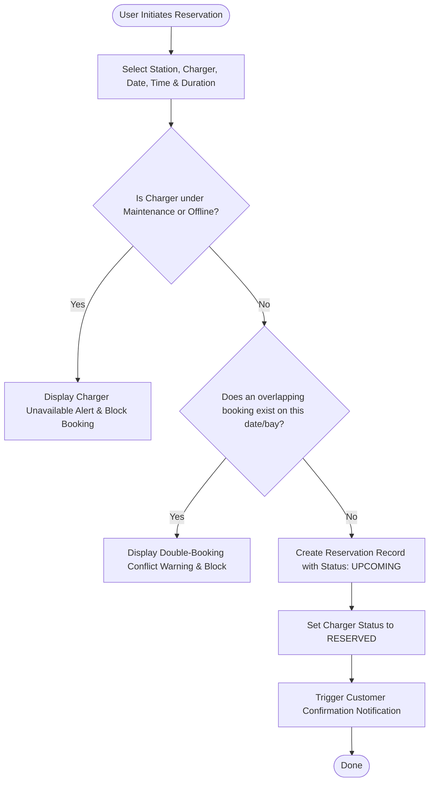

# ACADEMIC PROJECT DOCUMENTATION

# "EV Charging Station Management System"

**Course:** Web Technology Laboratory Work Project (LWP)  
**Project Classification:** Individual Web Application Project  
**Author:** College Student Candidate  

---

## Table of Contents
1. [Chapter 1 — Introduction](#chapter-1--introduction)
2. [Chapter 2 — Existing System](#chapter-2--existing-system)
3. [Chapter 3 — Proposed System](#chapter-3--proposed-system)
4. [Chapter 4 — System Requirements](#chapter-4--system-requirements)
5. [Chapter 5 — System Design & Architecture](#chapter-5--system-design--architecture)
6. [Chapter 6 — Database Design](#chapter-6--database-design)
7. [Chapter 7 — Implementation Details](#chapter-7--implementation-details)
8. [Chapter 8 — Testing Methodologies](#chapter-8--testing-methodologies)
9. [Chapter 9 — Results & User Interface](#chapter-9--results--user-interface)
10. [Chapter 10 — Conclusion & Future Enhancements](#chapter-10--conclusion--future-enhancements)

---

## Chapter 1 — Introduction

### 1.1 Background & Electric Vehicle Adoption
The transition toward sustainable transportation has led to exponential growth in Electric Vehicle (EV) adoption worldwide. Electric vehicles offer significant reductions in greenhouse gas emissions, lower operating costs, and reduced reliance on fossil fuels. However, unlike traditional internal combustion engine (ICE) vehicles that refuel in three minutes at ubiquitously available petrol pumps, EVs require between 20 minutes to several hours to recharge depending on battery capacity and charger output power.

### 1.2 The Need for Charging Infrastructure Management
The primary bottleneck confronting electric mobility is not vehicle manufacturing capacity, but **Charging Infrastructure Operations**. Charge Point Operators (CPOs) and commercial facility owners face serious operational hurdles:
* Unpredictable bay occupancy and queuing chaos at charging stations.
* High variance in vehicle battery capacities ($24\text{ kWh}$ to $100+\text{ kWh}$) and connector compatibility standards (CCS2, Type 2, CHAdeMO, GB/T).
* Grid load balancing and demand spikes during peak transit hours.
* Frequent charger downtime resulting from hardware cable degradation, high-voltage thermal cutoff, and firmware crashes.

An integrated web-based management platform is essential to unify charger availability, automated booking scheduling, energy metering, and technician dispatch into a single reliable operating system.

---

## Chapter 2 — Existing System

### 2.1 Overview of Current Practices
In conventional charging installations, operations are managed through disjointed, manual, or proprietary point-solutions:
* **Manual Record Keeping:** Many charging locations rely on handwritten entry logbooks or basic spreadsheets to track customer arrival times, units consumed, and manual payments.
* **Basic Ride/Booking Apps:** Existing commercial consumer apps focus primarily on locating GPS pins on a map, offering minimal or no visibility into whether a specific bay's connector is operational or undergoing repair.
* **Lack of Double-Booking Protection:** Drivers frequently arrive at a booked station only to find the bay occupied or overlapping with another customer's slot.

### 2.2 Limitations of the Existing System
1. **No Operational Transparency:** Inability to know real-time power availability, leading to driver range anxiety.
2. **Double Booking Collisions:** Multiple vehicles arriving simultaneously for the same high-power DC charger.
3. **No Dynamic Cost Estimation:** Drivers cannot calculate their expected charging cost or charging duration beforehand.
4. **Delayed Maintenance Turnaround:** Faulty chargers remain unflagged until a technician physically visits the site.

---

## Chapter 3 — Proposed System

### 3.1 Overview
The **EV Charging Station Management System** is an enterprise-grade web application tailored for Charge Point Operators and EV drivers. The system directly answers:
> *"Which charger is available, when can the customer use it, how much energy will be consumed, how long will charging take, and what will the estimated cost be?"*

### 3.2 Key Capabilities
* **Dynamic Bay Availability Board:** Real-time visual representation of charger bays across 5 distinct operational states: `Available`, `Charging`, `Reserved`, `Maintenance`, and `Offline`.
* **Conflict-Free Reservation Engine:** Algorithmic verification that prevents overlapping bookings on the same charger.
* **Smart Charging Calculator:** Mathematical model computing energy required, ideal charging time, and transparent monetary estimates before booking.
* **Live Session Simulator:** Real-time battery State of Charge (SoC) progression and kilowatt-hour accumulation.
* **Automated Maintenance Lockout:** Instant safety quarantine of malfunctioning chargers upon technician fault submission.

---

## Chapter 4 — System Requirements

### 4.1 Hardware Requirements
* **Processor:** 1.6 GHz Dual-Core Intel/AMD x86_64 or ARM processor (Minimum)
* **RAM:** 4 GB RAM (8 GB Recommended)
* **Storage:** 500 MB free hard drive space for codebase and database storage
* **Display Resolution:** 1366 × 768 or higher (Responsive across mobile, tablet, desktop)

### 4.2 Software Requirements
* **Operating System:** Windows 10/11, macOS, or Linux
* **Web Browser:** Google Chrome (v110+), Microsoft Edge (v110+), or Mozilla Firefox
* **Frontend Technologies:** HTML5, CSS3, JavaScript (ES6+), Bootstrap 5.3.3, Chart.js 4
* **Stage 2 Backend Stack:** Apache Tomcat / PHP 8.x, Java Servlets / JSP or PHP PDO
* **Database Management System:** MySQL 8.0+

### 4.3 Functional Requirements
* **FR-01:** System must maintain multi-hub stations and multi-bay chargers.
* **FR-02:** System must filter chargers by city, connector type, and power rating ($7.4\text{ kW}$ to $150\text{ kW}$).
* **FR-03:** System must enforce conflict-free slot booking.
* **FR-04:** System must simulate live energy transfer and battery progression.
* **FR-05:** System must compute itemized invoices including energy tariff, service fee, and GST.
* **FR-06:** System must provide role-based interfaces for Admin, Station Manager, Technician, and Customer.

---

## Chapter 5 — System Design & Architecture

### 5.1 Three-Tier System Architecture
```text
┌────────────────────────────────────────────────────────┐
│                   PRESENTATION TIER                    │
│   HTML5 • CSS3 • Bootstrap 5 • Chart.js • Vanilla JS   │
│   (Dashboard, Visual Charger Board, Smart Calculator)  │
└───────────────────────────┬────────────────────────────┘
                            │ HTTP / JSON / AJAX
┌───────────────────────────▼────────────────────────────┐
│                    APPLICATION TIER                    │
│   Role Authorization • Conflict Engine • Math Formulas │
│   (Stage 1: EVStateManager JS | Stage 2: Servlets/PHP) │
└───────────────────────────┬────────────────────────────┘
                            │ Prepared SQL / JDBC
┌───────────────────────────▼────────────────────────────┐
│                       DATA TIER                        │
│   Stage 1: Browser localStorage State Simulation       │
│   Stage 2: MySQL Relational Database (ev_charging_db)  │
└────────────────────────────────────────────────────────┘
```

### 5.2 Use Case Diagram
* **Customer:** Search Stations $\rightarrow$ Reserve Slot $\rightarrow$ Start Session $\rightarrow$ View Invoices $\rightarrow$ Register EV.
* **Station Manager:** Monitor Live Bay Status $\rightarrow$ Track Station Revenue $\rightarrow$ Review Utilization.
* **Technician:** Inspect Work Orders $\rightarrow$ Report Fault $\rightarrow$ Update Repair Status $\rightarrow$ Release Charger.
* **Admin:** Station & Charger CRUD $\rightarrow$ System Analytics $\rightarrow$ User Management $\rightarrow$ Pricing Configuration.

### 5.3 Conflict-Free Booking Flowchart


---

## Chapter 6 — Database Design

The relational database `ev_charging_db` is normalized to Third Normal Form (3NF).

### 6.1 Relational Schema
```text
users (user_id [PK], name, email, password_hash, role, phone, status, created_at)
stations (station_id [PK], station_code, station_name, address, city, latitude, longitude, contact_number, operating_hours, status)
pricing (pricing_id [PK], station_id [FK], price_per_kwh, service_fee, tax_percentage, effective_from)
chargers (charger_id [PK], station_id [FK], charger_code, connector_type, charging_power, status, installed_date, total_hours_used)
vehicles (vehicle_id [PK], user_id [FK], vehicle_number, vehicle_model, battery_capacity, current_battery_pct, connector_type, max_charging_power)
reservations (reservation_id [PK], reservation_code, user_id [FK], vehicle_id [FK], station_id [FK], charger_id [FK], reservation_date, start_time, duration_minutes, status)
charging_sessions (session_id [PK], session_code, reservation_id [FK], user_id [FK], vehicle_id [FK], station_id [FK], charger_id [FK], start_time, end_time, energy_consumed, duration_minutes, total_cost, status)
payments (payment_id [PK], session_id [FK], amount, payment_method, payment_date, status, transaction_reference)
maintenance (maintenance_id [PK], maintenance_code, charger_id [FK], technician_id [FK], issue, priority, reported_date, start_date, completion_date, status, remarks)
notifications (notification_id [PK], user_id [FK], title, message, type, is_read, created_at)
```

---

## Chapter 7 — Implementation Details

### 7.1 Smart Charging Calculator Formulas
$$\text{Energy Required (kWh)} = \text{Battery Capacity (kWh)} \times \frac{\text{Target SoC (\%)} - \text{Current SoC (\%)}}{100}$$
$$\text{Ideal Charging Duration (Hours)} = \frac{\text{Energy Required (kWh)}}{\text{Charger Power (kW)}}$$
$$\text{Charging Duration (Minutes)} = \text{Ideal Hours} \times 60$$
$$\text{Estimated Energy Cost (₹)} = \text{Energy Required} \times \text{Tariff Rate (₹/kWh)}$$

### 7.2 Charger Utilization Score Formula
$$\text{Utilization (\%)} = \frac{\text{Charging Hours Used}}{\text{Available Operating Hours (24 hrs)}} \times 100$$
Categorized into High ($\ge 75\%$), Normal ($40-74\%$), and Low ($< 40\%$).

---

## Chapter 8 — Testing Methodologies

| Test Case ID | Description | Input | Expected Output | Status |
| :--- | :--- | :--- | :--- | :--- |
| **TC-01** | Booking Conflict Detection | Same bay, same date, overlapping time window | Error alert displayed; booking blocked | **PASS** |
| **TC-02** | Maintenance Bay Lockout | Select charger currently under repair | Warning banner shown; submit button disabled | **PASS** |
| **TC-03** | Energy Calculator Accuracy | $40.5\text{ kWh}$ pack, $25\% \rightarrow 90\%$, $60\text{ kW}$ | $26.33\text{ kWh}$, $26\text{ mins}$, $₹394.95$ | **PASS** |
| **TC-04** | Live Session Timer | Click "Start Simulation" | Battery increments, kWh accumulates, live power updates | **PASS** |
| **TC-05** | Invoice Generation | Terminate session | Itemized invoice generated with energy cost, fee, & GST | **PASS** |
| **TC-06** | Fault Reporting Transition | Submit fault on charger CH-001 | Status immediately switches to `Maintenance` | **PASS** |

---

## Chapter 9 — Results & User Interface

The application interface consists of 13 interconnected pages designed with Bootstrap 5 and the custom VoltFlow design system:
1. `index.html`: Responsive homepage with platform metrics, workflow, and quick calculator preview.
2. `pages/dashboard.html`: 8 KPI cards, Chart.js energy trends, status donut, and live bay board.
3. `pages/stations.html`: Comprehensive directory of EV hubs with real-time bay availability counters.
4. `pages/station-details.html`: Detailed individual bay status grid for a chosen hub.
5. `pages/chargers.html`: Hardware inventory list with utilization scores and status toggles.
6. `pages/find-charger.html`: Multi-criteria search by city, connector, power, and availability.
7. `pages/vehicles.html`: Fleet management with battery graphic indicators and vehicle presets.
8. `pages/calculator.html`: Dedicated Smart Charging Calculator with live visual battery graphic.
9. `pages/charging-session.html`: Live interactive session simulator with dynamic timers.
10. `pages/billing.html`: Print-ready digital GST tax invoices and payment simulator.
11. `pages/maintenance.html`: Fault reporting, technician dispatch, and auto-lockout safeguards.
12. `pages/reports.html`: 5 analytical ledgers with Chart.js peak demand and CSV export.
13. `pages/login.html`: 1-click academic demo role switcher for all 4 user classes.

---

## Chapter 10 — Conclusion & Future Enhancements

### 10.1 Conclusion
The **EV Charging Station Management System** successfully fulfills all academic criteria for **LWP Review 01 (Stage 1 — Static Website)** while establishing the complete database and architectural foundation for **LWP Review 02 (Stage 2 — Dynamic Website with MySQL)**. The application moves beyond basic booking workflows to simulate realistic charging infrastructure management.

### 10.2 Future Scope
* OCPP 1.6 / 2.0.1 protocol integration for direct IoT hardware charger telemetry.
* Dynamic electricity pricing synced with grid open access and solar generation tariffs.
* Native mobile applications built on React Native or Flutter.
* Machine learning load balancing and predictive queuing algorithms.
